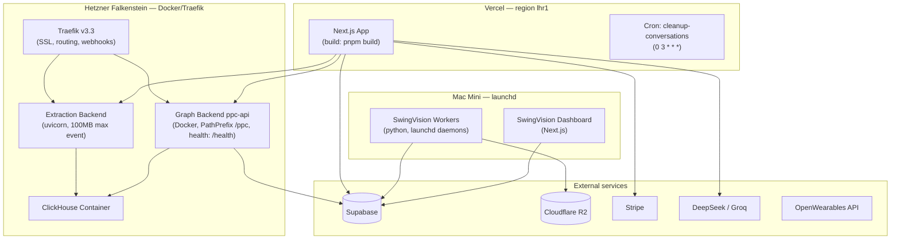

# Deployment topology

This document records the deployment surfaces observed in checked-in configuration. It distinguishes **configured** (present in source) from **verified deployed** (confirmed live). Only the configured state is evidenced here.

## Diagram

## Configured deployment evidence

### Vercel (app)

| Config | Value | Source |
|---|---|---|
| Region | `lhr1` | `vercel.json` |
| Build command | `HUSKY=0 pnpm run build` | `vercel.json` |
| Install command | `ensure-vendor-stubs.sh && build:courtviz && build:bodyviz && pnpm install --frozen-lockfile` | `vercel.json` |
| Cron | `cleanup-conversations` at `0 3 * * *` | `vercel.json` |
| Redirects | `/strava-auth-callback`, `/presentation/*` | `vercel.json` |

### Hetzner Falkenstein (graph backend)

| Config | Value | Source |
|---|---|---|
| Host | "Wearables-Data-Extraction" — Hetzner CX33, 116.202.100.150, Falkenstein, Germany (eu-central) | Owner-provided console screenshot, 2026-10-09 |
| Service | `ppc-api` Docker service | `ppd_backend/docker-compose.yml` |
| Proxy | Shared Traefik — router `ppc-api`, PathPrefix `/ppc`, stripprefix, port 8000, network `ppd-shared` | `ppd_backend/docker-compose.yml` |
| Public URL | `https://api.wearablesync.app/ppc` (`api.wearablesync.app` and `ppc.peakperformancedata.app` both resolve to 116.202.100.150; `/ppc/health` healthy 2026-10-09) | Owner verification, 2026-10-09 |
| Health check | `/health` | `api/main.py` |

Note: `render.yaml` is obsolete — Render is no longer used for this service (owner statement 2026-10-09). The stale `STRAVA_*` env-var question (DG-05) applied to `render.yaml` and is now moot for deployment config.

### Hetzner Helsinki (unverified)

| Config | Value | Source |
|---|---|---|
| Host | "Wearables-Data-Processing" — Hetzner CX23, 89.167.47.236, Helsinki, Finland (eu-central) | Owner-provided console screenshot, 2026-10-09 |
| Purpose | Unverified — `ppd_backend/scripts/deploy.sh` targets this server (Caddy, `ppc.peakperformancedata.app`), but DNS for that domain resolves to Falkenstein, so the script does not describe current production | `ppd_backend/scripts/deploy.sh` |

### Hetzner (extraction)

| Config | Value | Source |
|---|---|---|
| Proxy | Traefik v3.3 (SSL, routing) | `docker/docker-compose.yml` |
| App server | uvicorn with `--h11-max-incomplete-event-size 104857600` | `src/api/main.py` comment, Dockerfile |
| Database | ClickHouse container | `docker/docker-compose.yml` |
| Network | `ppd-network` + `ppd-shared` (external) | `docker/docker-compose.yml` |

### Mac Mini (SwingVision)

| Config | Value | Source |
|---|---|---|
| Worker daemon | launchd | `infra/launchd/` |
| R2 lifecycle | Configured | `infra/r2-lifecycle.json` |
| Devices | 5 iPhone SE | Pipeline docs (not config file) |

## What this document does not claim

- Whether any deployment is currently live and healthy (unverified).
- Actual environment variable values (secrets are not inspected).
- Network firewall rules or security group configuration.
- Whether the `STRAVA_*` env vars in `render.yaml` are still used or stale (DG-05).
- Whether the Python AI agent and Vision service have their own deployment configs (unconfirmed).
